<!-- Banner, letter and stats are generated: see assets/build.py and assets/stats.py -->

<a href="https://www.linkedin.com/in/aryanyadav-dev/">
  <picture>
    <source media="(prefers-color-scheme: dark)" srcset="https://raw.githubusercontent.com/Aryan-yadav15/Aryan-yadav15/main/assets/hero-dark.svg"/>
    
  </picture>
</a>

  <a href="https://www.linkedin.com/in/aryanyadav-dev/"><b>LinkedIn</b></a> &nbsp;·&nbsp;
  <a href="https://x.com/AryanYadav_15"><b>X</b></a> &nbsp;·&nbsp;
  <a href="https://instagram.com/aryanyadav.png"><b>Instagram</b></a> &nbsp;·&nbsp;
  <a href="mailto:aryanyadav.devop@gmail.com"><b>Email</b></a>

<picture>
  <source media="(prefers-color-scheme: dark)" srcset="https://raw.githubusercontent.com/Aryan-yadav15/Aryan-yadav15/main/assets/about-dark.svg"/>
  
</picture>

## The work

<table>
<tr>
<td width="50%" valign="top">

01 · FLAGSHIP
### [KhaoGully](https://khaoo-gully-customer-web.vercel.app)
A food-ordering platform, every surface of it: the [customer web app](https://github.com/Aryan-yadav15/khaooGully-customer-web), [restaurant dashboard](https://github.com/Aryan-yadav15/KhaoGully-restraunt-facing), [delivery navigator](https://github.com/Aryan-yadav15/khaao-gully-navigator), [inventory](https://github.com/Aryan-yadav15/inventory-management) and an [economics dashboard](https://github.com/Aryan-yadav15/KhaoGully-economics-dashboard).

TypeScript · React · Node

</td>
<td width="50%" valign="top">

02 · DEVELOPER TOOLS
### [DocRAG](https://github.com/Aryan-yadav15/DocAiAssist)
A VS Code extension that crawls and indexes library docs and gives Copilot fresh context. Hybrid BM25 and vector search, with embeddings computed locally.

TypeScript · Transformers.js · SQLite-vec

</td>
</tr>
<tr>
<td width="50%" valign="top">

03 · BROWSER
### [AI Form Filler](https://github.com/Aryan-yadav15/formfillerAi-Browser-extension)
A Chrome side-panel extension that fills Google Forms with Gemini 2.5 Flash, using context it picks up from your ChatGPT, Claude and Gemini chats.

TypeScript · Chrome MV3 · Gemini

</td>
<td width="50%" valign="top">

04 · DATA
### [NLP → SQL](https://github.com/Aryan-yadav15/Database-NLP-Query)
Ask a database a question in plain English and get a real query back.

Python · SQL

</td>
</tr>
</table>

ALSO &nbsp; Hackathon builds for [Deloitte](https://github.com/Aryan-yadav15/MailMesh-Delloite-Hackathon) and [Walmart](https://github.com/Aryan-yadav15/WalmartHackathon), plus [StockSmart](https://github.com/Aryan-yadav15/WoodpeckerStockSmart), [MultiLang Chat](https://github.com/Aryan-yadav15/MultiLang-ChatApp) and [Thrift Track](https://github.com/Aryan-yadav15/Thrift_Track).

## The map

<picture>
  <source media="(prefers-color-scheme: dark)" srcset="https://raw.githubusercontent.com/Aryan-yadav15/Aryan-yadav15/main/assets/map-dark.svg"/>
  
</picture>

Each repo's README, dependencies and file/route names are embedded with <code>bge-small-en-v1.5</code>, projected to 2D with UMAP, and labelled by zero-shot classification against a description of each domain. Source: <a href="map/embed.py"><code>map/embed.py</code></a>.

## The toolkit

<picture>
  <source media="(prefers-color-scheme: dark)" srcset="https://skillicons.dev/icons?i=ts%2Cjs%2Creact%2Cnodejs%2Cexpress%2Cpython%2Cfastapi%2Cjava%2Cpostgres%2Cmysql%2Cmongodb%2Cthreejs%2Cvercel%2Cfigma%2Cai%2Cps&perline=16&theme=dark"/>
  
</picture>

Also: Socket.io · JWT auth · React Router · browser and IDE extensions · RAG pipelines

## By the numbers

<picture>
  <source media="(prefers-color-scheme: dark)" srcset="https://raw.githubusercontent.com/Aryan-yadav15/Aryan-yadav15/output/stats-dark.svg"/>
  
</picture>

<picture>
  <source media="(prefers-color-scheme: dark)" srcset="https://raw.githubusercontent.com/Aryan-yadav15/Aryan-yadav15/output/snake-dark.svg"/>
  
</picture>

<i>Thanks for reading.</i> &nbsp;·&nbsp; 

